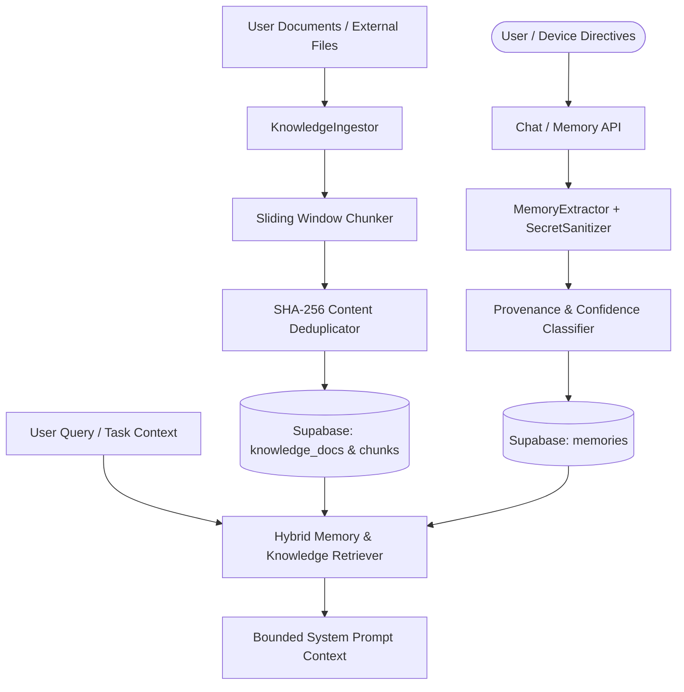

# System 2: Memory & Knowledge — Baseline Audit

**Repository:** `D:\Victor` (`origin: https://github.com/whitewolf251501-dot/Victor.git`)  
**Branch:** `main`  
**Base Commit:** `a643b42`  
**Timestamp:** 2026-11-18  

---

## 1. Scope & System Mission

The mission of System 2 (Memory & Knowledge) is to provide secure, useful, explainable long-term memory and knowledge retrieval with provenance, lifecycle controls, and bounded context delivery.

### Authoritative Acceptance Criteria (from SYSTEM_SPECIFICATION.md):
- [ ] **AC-01 (Owner Isolation & RLS):** Memory records are owner-scoped and protected by server-side authorization/RLS.
- [ ] **AC-02 (Provenance & Confidence):** Memory creation distinguishes user-stated facts, inferred candidates, and external-source facts with provenance and confidence metadata.
- [ ] **AC-03 (Bounded Relevance Retrieval):** Retrieval returns relevant records with source/provenance and strictly bounded limits.
- [ ] **AC-04 (Embedding Model & Versioning):** Embeddings have model/version metadata and a documented migration/re-embedding path.
- [ ] **AC-05 (RAG Document Ingestion & Chunking):** RAG ingestion handles file/source identity, chunking, deduplication, failure handling, and deletion propagation.
- [ ] **AC-06 (Correction & Deletion Invalidation):** User correction and deletion remove or invalidate derived embeddings/index entries as required.
- [ ] **AC-07 (Sensitive Data Redaction & Consent):** Sensitive information (API keys, credentials, tokens) is not automatically retained outside explicit consent.
- [ ] **AC-08 (Security & Retrieval Test Suite):** Retrieval is tested for relevance, stale/conflicting facts, empty results, prompt injection defense, and cross-owner isolation.
- [ ] **AC-09 (Lifecycle, Retention & Export):** Backups, retention, operational limits, and JSON/JSONL export are documented and implemented.

---

## 2. Current Implementation State

### 2.1 Existing Modules
1. `packages/shared/src/types/memory.ts`:
   - Basic `Memory` interface: `id`, `ownerId`, `category`, `content`, `importance`, `createdAt`, `updatedAt`, `source`.
   - Missing: `provenance` ('user_stated' | 'inferred' | 'external_source' | 'system'), `confidence` (number), `sourceRef` / `provenanceUri`, and embedding metadata (`embeddingModel`, `embeddingVersion`).
2. `packages/core/src/memory/memory-manager.ts`:
   - CRUD on Supabase `memories` table: `save`, `retrieve`, `getById`, `update`, `delete`, `search`, `checkDuplicate`.
   - Solid baseline with `ownerId` checks, but lacks RAG knowledge document management, embedding integration, sensitive token scrubbing prior to storage, and structured export.
3. `packages/core/src/memory/memory-retriever.ts`:
   - Keyword scoring + importance weighting + recency decay.
   - Operates in-memory over table scan without vector similarity or hybrid ranking fallback.
4. `packages/core/src/memory/memory-extractor.ts`:
   - Regex-based heuristic memory extraction (`extractMemoriesFromMessage`).
   - Does not sanitize secrets or credential patterns prior to candidate generation.
5. `supabase/migrations/20261101000001_victor_foundation.sql`:
   - `memories` table with basic RLS policies.
   - Lacks knowledge documents and document chunks tables for RAG ingestion.
   - Lacks `provenance`, `confidence`, and embedding fields.
6. `apps/web/src/app/api/victor/memories/`:
   - REST API routes (`GET`, `POST`, `PATCH`, `DELETE`) with session authentication.
   - Functional, but lacks knowledge document RAG ingestion and export endpoints.

---

## 3. Gap Analysis Matrix

| Requirement | Current State | Gap | Action Required |
| :--- | :--- | :--- | :--- |
| **AC-01: Owner Isolation & RLS** | Implemented in SQL and `MemoryManager` | Verified, but needs schema update for provenance & knowledge documents | Create migration `20261101000005_memory_knowledge_hardening.sql` |
| **AC-02: Provenance & Confidence** | Only generic `source: string` present | No structured provenance type or confidence score stored in database or contract | Update `Memory` type and `MemoryManager.save` to require provenance & confidence |
| **AC-03: Bounded Relevance Retrieval** | Keyword scoring + recency | No hybrid vector similarity ranking or cosine similarity adapter | Implement `HybridMemoryRetriever` supporting cosine vector + keyword scoring |
| **AC-04: Embedding Model & Versioning** | No embedding metadata or model tracking | Missing embedding representation and version tracking | Define `EmbeddingMetadata` with model name, version, and dimension |
| **AC-05: RAG Ingestion & Chunking** | Not implemented | No document ingestion, sliding window chunking, or deduplication | Create `KnowledgeIngestor` with chunking, SHA-256 deduplication, and cascading delete |
| **AC-06: Correction & Invalidation** | Basic memory update/delete exists | Deleting document or memory does not invalidate/purge associated chunks or vectors | Implement cascade invalidation in `KnowledgeIngestor` and `MemoryManager` |
| **AC-07: Sensitive Data Redaction** | `SecretSanitizer` exists in System 6 | Not applied during memory extraction or storage | Integrate `SecretSanitizer` into `MemoryExtractor` and `MemoryManager.save` |
| **AC-08: Security & Retrieval Tests** | 0 dedicated tests for memory | No automated tests for cross-owner isolation, injection defense, or retrieval | Create complete test suites in `packages/core/test/memory/` |
| **AC-09: Retention & Export** | Not implemented | No memory export or retention policy enforcement | Implement JSON/JSONL memory export and retention pruner in `MemoryManager` |

---

## 4. Architecture & Data Flow

---

## 5. Baseline Test Status

Baseline tests currently passing:
- 82/82 tests pass across `packages/core` (System 6: 33 tests, System 7: 20 tests, System 1: 29 tests).
- 0 tests currently exist for System 2 memory modules.
- Target: 100% test coverage for System 2 requirements.
