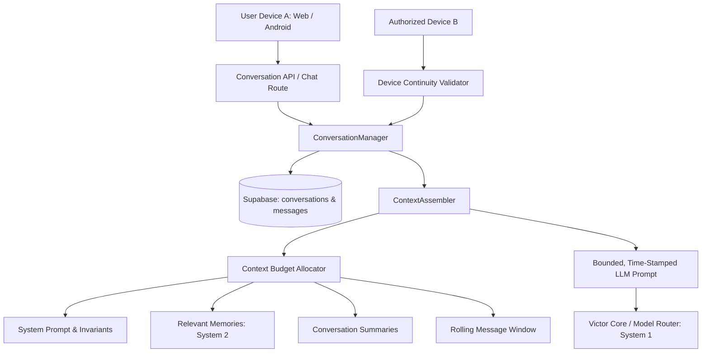

# System 3: Context & Conversation — Baseline Audit

**Repository:** `D:\Victor` (`origin: https://github.com/whitewolf251501-dot/Victor.git`)  
**Branch:** `main`  
**Base Commit:** `a643b42`  
**Timestamp:** 2026-11-18  

---

## 1. Scope & System Mission

The mission of System 3 (Context & Conversation) is to maintain coherent conversations and task continuity across sessions and authorized devices, assembling only relevant and permission-appropriate context within strict context-window budgets.

### Authoritative Acceptance Criteria (from SYSTEM_SPECIFICATION.md):
- [ ] **AC-01 (Persistence & Owner Isolation):** Conversations and messages persist with owner isolation and stable IDs.
- [ ] **AC-02 (Bounded Context Assembly):** Context assembly is bounded, deterministic where possible, and includes provenance/time metadata.
- [ ] **AC-03 (Relevance & Context Filtering):** Only authorized, relevant memories and device context enter the model context.
- [ ] **AC-04 (Cross-Device Continuity):** A task/conversation can be resumed on another authorized device without duplicating or corrupting state.
- [ ] **AC-05 (Concurrent Ordering & Race Control):** Concurrent messages and updates have defined ordering/conflict behavior.
- [ ] **AC-06 (Safe Conversation Summarization):** Summaries preserve important decisions and open tasks without inventing facts.
- [ ] **AC-07 (Cascade Deletion & Retention):** Deletion/retention rules propagate to derived summaries and indexes as required.
- [ ] **AC-08 (Test Coverage):** Tests cover pagination, concurrent sessions, stale clients, missing memory, context overflow, and owner isolation.

---

## 2. Current Implementation State

### 2.1 Existing Modules
1. `packages/shared/src/types/conversation.ts`:
   - Basic types: `Message`, `Conversation`, `MessageRole`, `MessageId`, `ConversationId`.
   - Missing: `ConversationSummary`, `ContextBudget`, `AssembledContext`, `SequenceNumber` / message order tracking.
2. `packages/core/src/conversation/conversation-manager.ts`:
   - Minimal utility functions: `getOrCreateConversation`, `getRecentMessages`, `formatHistoryForGemini`.
   - Missing: context assembler with token budgeting, safe summarization engine, pagination support, and cross-device session handover tracking.
3. `supabase/migrations/20261101000001_victor_foundation.sql`:
   - `conversations` table and `messages` table with basic RLS.
   - Missing: `conversation_summaries` table, sequence numbering for deterministic ordering, and context budget metadata.
4. `apps/web/src/app/api/victor/conversations/`:
   - `GET /api/victor/conversations` (lists recent conversations).
   - `POST /api/victor/conversations` (creates a conversation).
   - `GET /api/victor/conversations/[id]` (fetches conversation and messages).
   - Missing: cursor-based pagination, deletion endpoint (`DELETE /api/victor/conversations/[id]`), and summary generation endpoint.

---

## 3. Gap Analysis Matrix

| Requirement | Current State | Gap | Action Required |
| :--- | :--- | :--- | :--- |
| **AC-01: Persistence & Owner Isolation** | Basic tables exist in SQL | Working, but lacking sequence order and summary persistence | Add migration `20261101000006_conversation_context_hardening.sql` |
| **AC-02: Bounded Context Assembly** | Ad-hoc array concatenation in chat route | No token/char budget allocator or budget manager | Implement `ContextAssembler` with token/char budgeting and priority allocation |
| **AC-03: Relevance Filtering** | Basic memory injection | No validation of device capabilities or task states into context | Integrate device profile and active task context into `ContextAssembler` |
| **AC-04: Cross-Device Continuity** | DeviceId stored on message | No explicit device handover or cross-device resume logic | Implement cross-device continuity validator in `ConversationManager` |
| **AC-05: Concurrent Ordering** | Ordered by `created_at` timestamp | Timestamp collisions on high-concurrency turns | Add monotonic sequence counter / deterministic sorting in `ConversationManager` |
| **AC-06: Safe Summarization** | None | Conversation history grows indefinitely without safe summaries | Implement `ConversationSummarizer` extracting decisions, tasks, and state |
| **AC-07: Cascade Deletion** | Conversations cascade delete messages in SQL | Does not clean up derived summaries or session context caches | Implement cascading delete in `ConversationManager` and `DELETE` route |
| **AC-08: Test Coverage** | 0 dedicated tests for conversation | Missing pagination, budgeting, and isolation tests | Create comprehensive test suites in `packages/core/test/conversation/` |

---

## 4. Architecture & Data Flow

---

## 5. Baseline Test Status

Baseline tests currently passing:
- 103/103 tests pass across `packages/core` (Systems 6, 7, 1, 2).
- 0 tests currently exist for System 3.
- Target: 100% test coverage for System 3 requirements.
